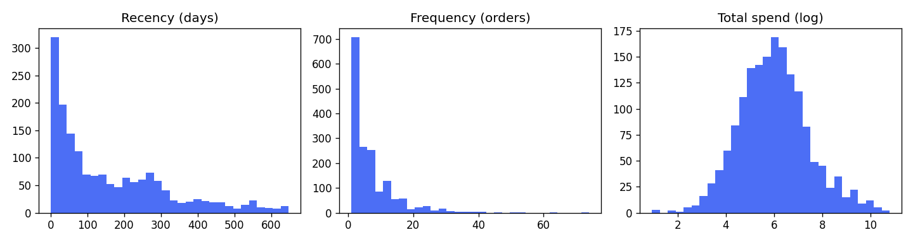
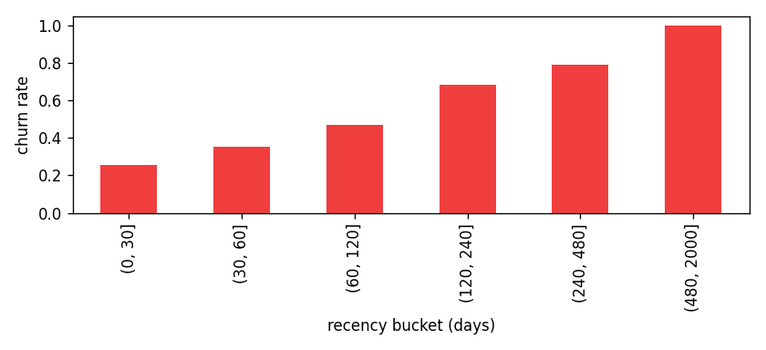
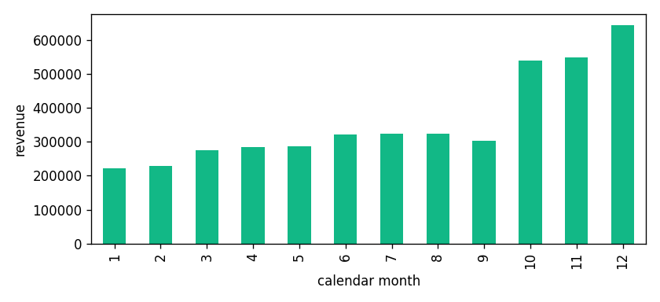

# Exploratory Data Analysis

Customers analysed: **1,668**; churn rate in the 90-day window: **54.3%**.

## Strongest correlations with churn
- `recency_days`: +0.472
- `engagement_score`: -0.443
- `frequency`: -0.305

## Strongest correlations with log next-90-day spend
- `engagement_score`: +0.487
- `recency_days`: -0.452
- `frequency`: +0.341

## Multicollinearity (VIF on the final model features, max 7.2)
- `engagement_score`: 7.2
- `recency_days`: 7.2
- `tenure_days`: 4.7
- `frequency`: 4.3
- `avg_basket_size`: 2.6

## Hypotheses for the modelling stage
- H1. Recency is the dominant churn signal (corr with churn +0.47); models should rank it first.
- H2. Order frequency and spend protect against churn (corr -0.31 and -0.13); loyal high-spend customers need little intervention.
- H3. A declining monthly order trend (purchase_trend corr -0.08) adds signal beyond RFM.
- H4. Q4 carries 40% of revenue, so seasonal customers will look 'churned' outside the season; seasonal_concentration should help separate them.
- H5. The top market holds 89% of revenue; country features will matter little for the main market but may flag niche overseas buyers.
- H6. Return-heavy customers form a separate behavioural group; the autoencoder should surface them as anomalies.
